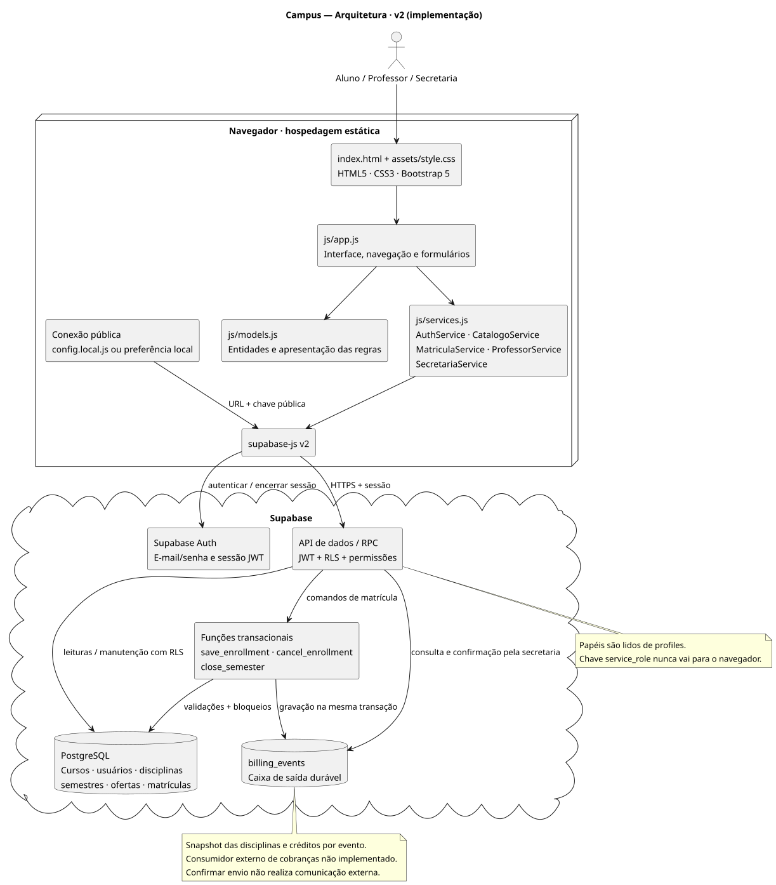
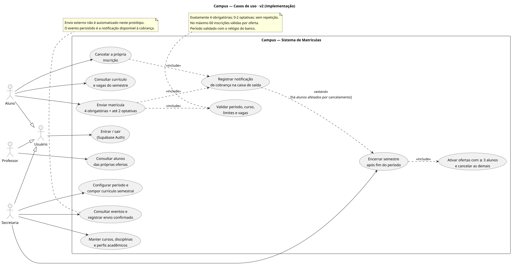

# Campus — Sistema de Matrículas


> Laboratório 03 de Desenvolvimento de Interfaces Web (DIW) — Engenharia de Software. Professor: João Paulo Carneiro Aramuni. Valor do laboratório: 15 pontos.

Aplicação para organizar o currículo semestral, realizar e cancelar matrículas, consultar turmas e registrar notificações para cobrança. Desenvolvida com **HTML5, CSS3, JavaScript, Bootstrap 5 e Supabase**, conforme o enunciado.

## Status do projeto

Código do protótipo e modelos UML versionados. A conexão pública com o projeto Supabase do autor está incluída em `js/config.js`, e a estrutura do banco já foi instalada nesse projeto. Ao executar a aplicação, não é necessário informar novamente a URL ou a chave pública. As contas são criadas e administradas no Supabase Auth; senhas não são publicadas no repositório. O login remoto ainda precisa ser validado com uma conta cadastrada. A validação local e seus limites estão descritos em [Testes](#testes).

Este README adapta as seções pertinentes do [template indicado pelo professor](https://github.com/joaopauloaramuni/desenvolvimento-de-interfaces-web/blob/main/TEMPLATES/template_README.md). Exemplos de outras tecnologias, arquivos de infraestrutura sem uso e informações não aplicáveis foram retirados.

## Índice

- [Links úteis](#links-úteis)
- [Sobre o projeto](#sobre-o-projeto)
- [Funcionalidades principais](#funcionalidades-principais)
- [Histórias de usuário](#histórias-de-usuário)
- [Tecnologias utilizadas](#tecnologias-utilizadas)
- [Arquitetura e modelos UML](#arquitetura-e-modelos-uml)
- [Instalação e execução](#instalação-e-execução)
- [Publicação](#publicação)
- [Estrutura de pastas](#estrutura-de-pastas)
- [Demonstração](#demonstração)
- [Testes](#testes)
- [Documentações utilizadas](#documentações-utilizadas)
- [Autor](#autor)

## Links úteis

- [Casos de uso — versão final](docs/modelos/v2/casos-de-uso.svg)
- [Classes — versão final](docs/modelos/v2/classes.svg)
- [Arquitetura — versão final](docs/modelos/v2/arquitetura.svg)
- [Evolução dos modelos e rastreabilidade](docs/modelos/README.md)
- [Estrutura e regras do banco](supabase/schema.sql)
- [Currículo inicial para demonstração](supabase/seed.sql)

## Sobre o projeto

A secretaria mantém cursos, disciplinas, alunos e professores e gera as ofertas de cada semestre. O aluno consulta o currículo do seu curso e envia quatro primeiras opções, com até duas alternativas. O professor consulta os alunos das suas ofertas. Ao final do período, a secretaria encerra o semestre de matrículas: ofertas com pelo menos três inscritos ficam ativas; as demais são canceladas.

### Regras adotadas

| Regra | Comportamento implementado |
| --- | --- |
| Quatro obrigatórias e até duas optativas | Cada envio completo exige **exatamente 4** obrigatórias e **0 a 2** optativas, todas distintas e pertencentes ao curso do aluno e ao semestre escolhido. |
| Alternativas | Optativas são inscrições reais, contam no limite de vagas e no mínimo para ativação. O enunciado não define promoção automática de alternativas; ela não foi inventada. |
| Período de matrícula | Inclusão, alteração e cancelamento só são aceitos a partir do início, inclusive, e antes do fim, exclusive, usando o relógio do banco. Semestre encerrado não aceita alterações. |
| Máximo de 60 alunos | O banco impede ultrapassar a capacidade, inclusive em pedidos simultâneos. Oferta lotada não recebe novas inscrições. |
| Mínimo de 3 alunos | No encerramento, ofertas com menos de três inscrições válidas são canceladas; as demais ficam ativas. O encerramento ocorre depois da data final. |
| Cancelamento pelo aluno | É individual e permitido durante o período, mesmo que o aluno fique com menos de quatro primeiras opções. Um novo envio completo volta a exigir quatro. |
| Cobrança | O envio grava uma notificação durável na mesma transação da matrícula. Cancelamentos e encerramento atualizam a cobrança por novos eventos. Não são definidos preços pelo enunciado. |
| Login | Senhas e sessões ficam sob responsabilidade do Supabase Auth. O papel não pode ser escolhido pelo aluno na interface. |
| Integridade dos cadastros | Disciplina com histórico de matrícula preserva seu curso. Professor atribuído a oferta e aluno com matrícula vigente preservam seus vínculos acadêmicos enquanto o semestre não for encerrado. |

**Limite da integração de cobrança:** a caixa de saída (`billing_events`) representa a notificação persistente ao sistema de cobranças. A secretaria pode consultar e marcar um evento como enviado após o envio por seu processo externo. Não existe serviço de cobrança externo fornecido pelo enunciado, nem integração HTTP fictícia. Marcar como enviado não dispara e-mail, pagamento ou requisição externa.

## Funcionalidades principais

| Perfil | Funcionalidades |
| --- | --- |
| Aluno | Login, consulta do currículo e vagas, seleção de obrigatórias/optativas, envio da matrícula, consulta e cancelamento das próprias inscrições. |
| Professor | Login, consulta das suas ofertas e lista de alunos matriculados em cada uma. |
| Secretaria | Login, manutenção de cursos e disciplinas, edição dos perfis de alunos e professores, períodos, composição do currículo semestral, encerramento e consulta da caixa de saída de cobrança. |

A criação de contas com senha é feita no painel administrativo do Supabase Auth, sem expor credenciais administrativas no navegador. A secretaria mantém nome, papel e vínculo acadêmico dos usuários já criados.

## Histórias de usuário

| ID | História | Critérios de aceitação |
| --- | --- | --- |
| HU01 | Como usuário, quero entrar com e-mail e senha para acessar minha área. | Credenciais são validadas no Supabase Auth; falha não concede acesso; sessão identifica o perfil e a saída encerra o acesso. |
| HU02 | Como secretaria, quero manter cursos e suas disciplinas para organizar a formação acadêmica. | Curso possui nome e créditos; disciplina possui código, nome, créditos e curso; vínculos são preservados por chaves estrangeiras. |
| HU03 | Como secretaria, quero manter alunos e professores para vincular pessoas ao sistema. | Contas são provisionadas no Auth; apenas secretaria altera papel e dados acadêmicos; aluno é associado a um curso; usuários comuns não se promovem. |
| HU04 | Como secretaria, quero cadastrar o período e as ofertas do semestre para publicar o currículo. | Semestre possui início e fim válidos; oferta associa semestre, disciplina e professor; o currículo fica disponível para consulta. |
| HU05 | Como aluno, quero consultar disciplinas e vagas para planejar minha matrícula. | Catálogo corresponde ao semestre e ao meu curso; mostra professor, créditos, situação e ocupação; lotação impede novas inscrições. |
| HU06 | Como aluno, quero enviar quatro obrigatórias e até duas optativas para me inscrever no semestre. | Exige 4 primeiras opções, aceita 0–2 alternativas distintas; valida período e vagas no servidor; falha desfaz toda a operação; envio válido persiste inscrições e evento de cobrança. |
| HU07 | Como aluno, quero cancelar uma inscrição para corrigir minha matrícula. | Posso cancelar somente minha inscrição, durante o período; a vaga é liberada e é registrado evento de cobrança; fora do prazo a operação é recusada. |
| HU08 | Como secretaria, quero encerrar o período para definir quais disciplinas ocorrerão. | Antes do fim a operação é recusada; com 3 ou mais inscritos a oferta fica ativa; com menos de 3 fica cancelada e suas matrículas são canceladas; o semestre fica fechado. |
| HU09 | Como professor, quero consultar os alunos das minhas disciplinas para acompanhar as turmas. | Listagem mostra apenas inscrições válidas de ofertas que leciono; outro professor não acessa minha lista. |
| HU10 | Como responsável pela cobrança, quero receber o registro das inscrições para processar as disciplinas do semestre. | A mesma transação grava matrícula e evento; eventos podem ser consultados pela secretaria; alterações produzem novos eventos; o estado de envio é explícito e só a secretaria pode alterá-lo. |

## Tecnologias utilizadas

| Camada | Tecnologia e finalidade |
| --- | --- |
| Estrutura | HTML5 semântico e formulários nativos. |
| Interface | Bootstrap 5, CSS3 e layout responsivo. |
| Lógica | JavaScript em módulos ES, modelos de domínio e serviços. |
| Banco | PostgreSQL no Supabase, integridade referencial, transações e funções SQL. |
| Autenticação | Supabase Auth com e-mail/senha. |
| Acesso aos dados | Biblioteca `supabase-js` v2. |
| Autorização | Row Level Security (RLS), papéis acadêmicos e validações nas funções do banco. |
| Modelagem | PlantUML com fontes editáveis `.puml` e imagens `.svg`. |

O navegador carrega Bootstrap e `supabase-js` por CDN. É necessária conexão com a internet e com o projeto Supabase. Não há etapa de compilação nem framework adicional.

## Arquitetura e modelos UML



A interface chama serviços JavaScript, que utilizam `supabase-js`. O Supabase Auth identifica o usuário; o PostgreSQL autoriza e valida operações. As regras críticas permanecem no banco para não depender de verificações do navegador. A chave pública identifica o projeto, enquanto RLS e as funções controlam o acesso aos dados.




As versões [v1](docs/modelos/v1) e [v2](docs/modelos/v2) preservam, respectivamente, a análise/projeto inicial e o refinamento após a implementação. O [registro de evolução](docs/modelos/README.md) explica as mudanças e relaciona os modelos ao código. Nenhum feedback de aula foi fornecido nesta entrega; as alterações documentadas decorrem da implementação e revisão dos requisitos, sem atribuição fictícia ao professor.

## Instalação e execução

### Pré-requisitos

- Navegador moderno com módulos JavaScript habilitados.
- Python 3 para servir os arquivos localmente, ou outro servidor HTTP estático.
- Conta institucional cadastrada no Supabase Auth para usar o projeto configurado.
- Para reproduzir o banco em outro projeto: acesso administrativo ao SQL Editor e à área Authentication desse projeto.
- Node.js 22 ou superior e npm para executar os testes JavaScript, caso desejado.

### 1. Preparar um banco próprio, se necessário

O projeto do autor já possui a estrutura instalada. Para usar essa conexão, siga diretamente para [Executar](#3-executar) e entre com uma conta cadastrada. Os passos abaixo são para reproduzir o sistema em **um novo projeto Supabase**; não execute novamente `schema.sql` sobre o projeto já configurado.

1. Crie um projeto em [supabase.com](https://supabase.com/).
2. No **SQL Editor**, execute integralmente [supabase/schema.sql](supabase/schema.sql). O esquema é para um projeto novo; não o aplique sobre um banco de produção existente.
3. Execute [supabase/seed.sql](supabase/seed.sql) para criar Engenharia de Software, oito disciplinas e as ofertas do semestre 2027.1. O período começa um dia antes da execução e termina 30 dias depois. O seed pode ser repetido sem duplicar esses registros; repetir não redefine as datas. Não contém senhas nem cria contas de autenticação.
4. Em **Authentication → Users**, crie os usuários necessários com e-mail e senha, confirmando o e-mail quando apropriado. Use pelo menos uma secretaria, um professor e alunos para a apresentação.
5. Promova a conta da secretaria pelo SQL Editor conforme o exemplo a seguir. Faça isso por um canal administrativo confiável, nunca no JavaScript público.

```sql
-- Substitua pelo e-mail da conta criada em Authentication → Users.
update public.profiles
set role = 'secretaria'
where id = (select id from auth.users where email = 'secretaria@seu-dominio.edu.br');
```

Depois do primeiro login da secretaria, use a área de usuários para ajustar os nomes, papéis e cursos das demais contas. Associe o aluno ao curso cadastrado; atribua às ofertas um perfil com papel `professor`. Sem essas associações, o catálogo ou a lista de turmas poderá ficar vazio.

### 2. Conexão pública incluída e configuração de outro projeto

O arquivo versionado `js/config.js` fornece a URL e a chave pública **publishable** do projeto Supabase do autor. Essa é a conexão padrão da entrega e dispensa preenchimento manual. O acesso aos dados continua sujeito à sessão do Supabase Auth, às políticas RLS e às permissões do banco.

Para usar **outro projeto**, copie sua **Project URL** e sua chave pública **anon/publishable** no painel Supabase e escolha uma das formas abaixo:

- Na tela de acesso, use **Configurar conexão** e informe os dois valores. A preferência é guardada neste navegador.
- Ou copie `js/config.example.js` para `js/config.local.js` e substitua os valores de exemplo. Esse arquivo é ignorado pelo Git.

```js
export const config = {
  supabaseUrl: 'https://SEU-PROJETO.supabase.co',
  supabaseKey: 'SUA_CHAVE_PUBLICA_ANON_OU_PUBLISHABLE'
};
```

Uma configuração salva no navegador tem prioridade sobre `config.local.js`; esse arquivo, quando presente, tem prioridade sobre `config.js`.

Chaves públicas anon/publishable são destinadas ao uso no navegador e podem constar na configuração pública. Use somente esse tipo de chave. `service_role`, chaves secretas, segredos do banco e senhas nunca pertencem ao front-end ou ao repositório. As políticas RLS e as permissões do banco protegem os dados mesmo quando a chave pública é conhecida.

### 3. Executar

Na raiz do repositório:

```bash
python3 -m http.server 5500
```

Abra <http://localhost:5500>. Não abra `index.html` diretamente com `file://`, pois a aplicação utiliza módulos ES.

Entre com uma conta já criada no Supabase Auth. A secretaria pode conferir o período do semestre, os vínculos acadêmicos e os professores das ofertas. Se o período já venceu, crie um novo semestre e suas ofertas. Para realizar a matrícula, o aluno deve estar vinculado ao mesmo curso das disciplinas. As credenciais de cada conta são fornecidas individualmente pelo responsável pelo projeto, sem publicação no README.

## Publicação

O projeto pode ser servido por qualquer hospedagem estática, inclusive GitHub Pages, a partir da raiz. A conexão pública padrão acompanha `js/config.js`; para outro projeto Supabase, use a configuração da interface ou um arquivo local apropriado. `config.local.js` não está no repositório. Não é necessário publicar `node_modules`, dependências baixadas, capturas temporárias ou ferramentas de modelagem. As regras permanecem no Supabase; um novo projeto precisa receber os scripts antes do uso.

## Estrutura de pastas

```text
.
├── index.html                 # Interface e acesso
├── assets/                    # Estilos e identidade visual
├── js/                        # Aplicação, modelos, serviços e configuração pública
├── supabase/
│   ├── schema.sql             # Tabelas, funções, gatilhos, RLS e permissões
│   ├── seed.sql               # Curso e currículo de exemplo, sem contas/senhas
│   └── tests.sql              # Regressão transacional, com rollback das fixtures
├── docs/
│   └── modelos/
│       ├── README.md          # Evolução e rastreabilidade
│       ├── v1/                # UML inicial: fontes e imagens
│       └── v2/                # UML final: fontes e imagens
├── tests/                     # Verificações das regras e contratos
├── package.json               # Módulos ES e comando dos testes; sem dependências
├── .gitignore                 # Exclui configuração local e artefatos temporários
└── README.md
```

## Demonstração

A aplicação inicia com a conexão pública incluída. Entre com uma conta cadastrada para acessar os dados do Supabase conforme seu perfil. O login e o fluxo conectado devem ser conferidos com as contas reais do projeto.

## Testes

### Regras do banco

Em um **projeto Supabase de teste**, depois de instalar `schema.sql`, execute [supabase/tests.sql](supabase/tests.sql) integralmente no SQL Editor como administrador. O script cria fixtures internas sem senha de login, verifica as regras e termina com `ROLLBACK`; uma asserção que falhe aborta a execução.

A regressão cobre papéis e RLS, tentativa de promoção pelo aluno, escrita direta proibida, seleção 4+2, notificação transacional, repetição sem duplicação, cancelamento, privacidade entre alunos, lista do professor, encerramento após o prazo, mínimo de três, teto de 60, recusa da 61ª inscrição sem gravar matrícula parcial, confirmação de eventos pela secretaria e proteção dos vínculos acadêmicos e do histórico durante alterações administrativas.

**Validação executada:** esquema, seed e as **32 asserções da regressão SQL** aprovados em PostgreSQL local via PGlite, com o contexto de autenticação de teste reproduzido e sem fixtures persistidas após o rollback. Isso valida funções, restrições e políticas do banco; não valida login real no Supabase Auth remoto. Os bloqueios que protegem operações concorrentes foram revisados no código SQL, mas não houve teste de requisições simultâneas.

### Verificações remotas de leitura

Com a configuração pública do projeto, os endpoints de saúde e configuração do Supabase Auth responderam **HTTP 200**. Sem sessão autenticada, as consultas às sete tabelas públicas e à função `offering_catalog` foram recusadas com **HTTP 401 / código PostgreSQL 42501**, conforme as permissões previstas. Essas verificações confirmam a disponibilidade dos endpoints e a recusa do acesso anônimo; não comprovam login ou operações de um usuário autenticado.

### Interface e JavaScript

Na raiz do repositório, sem instalação de dependências:

```bash
npm test
```

A suíte usa o executor nativo do Node.js para verificar seleção, períodos, cálculo de vagas e contratos dos serviços. **Os 15 testes passaram.** Erros retornados pelo Supabase são propagados; uma seleção inválida não inicia uma chamada de matrícula. O resultado de `npm test` pode agrupar os casos em um único arquivo; para exibir os casos individualmente, execute `node tests/domain-services.test.js`.

Os módulos passaram também na verificação de sintaxe:

```bash
node --check js/app.js
node --check js/models.js
node --check js/services.js
```

Foram aprovadas ainda **27 verificações de DOM com serviços simulados**, cobrindo configuração da conexão, navegação dos três perfis, seleção 4+2, busca, formulários, proteção da saída de texto e disponibilidade do encerramento. Essa verificação não valida aparência visual ou integração remota.

A prévia no navegador não pôde ser iniciada durante a validação local por uma restrição do ambiente ao abrir a porta do servidor. Após configurar o projeto Supabase, os 15 testes Node e as 27 verificações de DOM com serviços simulados passaram novamente. O login remoto, o fluxo completo com contas reais e a aparência responsiva em um navegador real ainda não foram validados.

## Documentações utilizadas

- [Bootstrap 5](https://getbootstrap.com/docs/5.3/)
- [JavaScript — módulos ES](https://developer.mozilla.org/pt-BR/docs/Web/JavaScript/Guide/Modules)
- [Supabase JavaScript](https://supabase.com/docs/reference/javascript/introduction)
- [Supabase Auth](https://supabase.com/docs/guides/auth)
- [Supabase Row Level Security](https://supabase.com/docs/guides/database/postgres/row-level-security)
- [PostgreSQL — bloqueios](https://www.postgresql.org/docs/current/explicit-locking.html)
- [PlantUML](https://plantuml.com/)
- [Template do README — Prof. João Paulo Aramuni](https://github.com/joaopauloaramuni/desenvolvimento-de-interfaces-web/blob/main/TEMPLATES/template_README.md)

## Autor

**Arthur Rodrigues Miranda** — [arthurrmiranda7-eng](https://github.com/arthurrmiranda7-eng).

Trabalho acadêmico da disciplina DIW, desenvolvido a partir do enunciado do Laboratório 03 e das referências acima.
