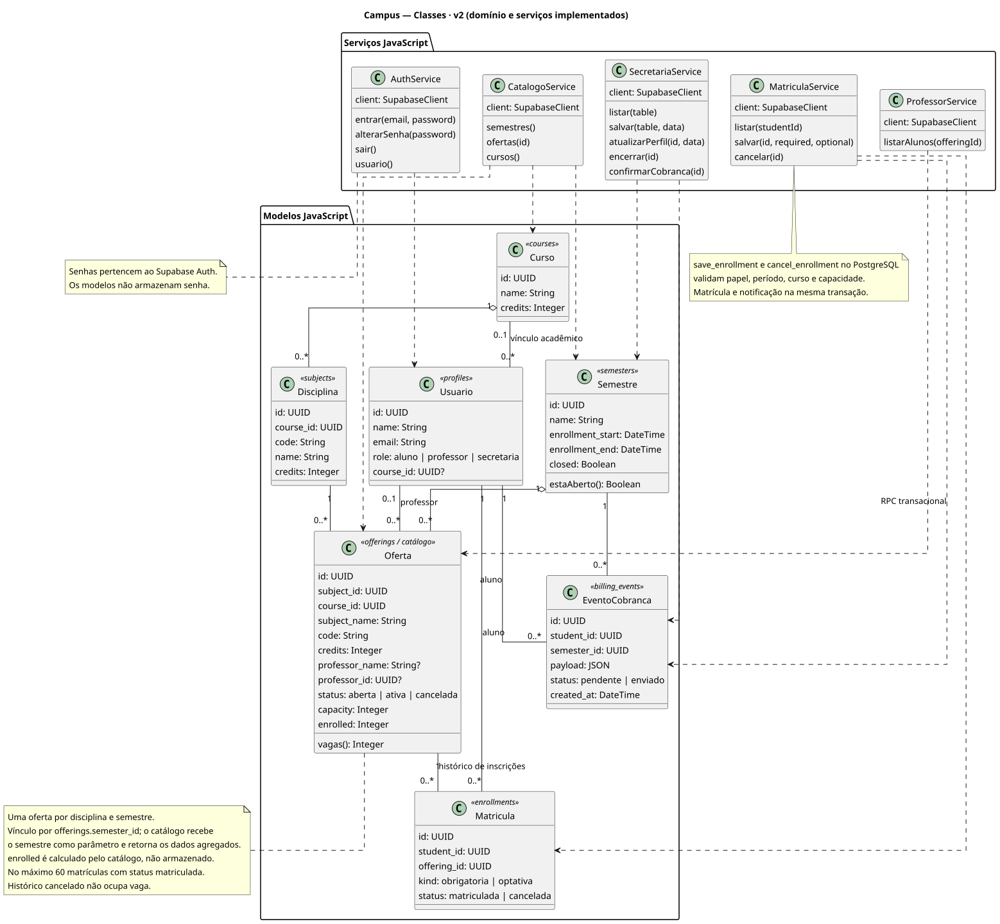

# Campus — Sistema de Matrículas


Projeto do Laboratório 03 de Desenvolvimento de Interfaces Web, do curso de Engenharia de Software. Professor: João Paulo Carneiro Aramuni.

O Campus organiza o currículo semestral e as matrículas de uma universidade. A aplicação usa **HTML5, CSS3, JavaScript, Bootstrap 5 e Supabase** e reúne as áreas de aluno, professor e secretaria.

**[Acessar o sistema](https://arthurrmiranda7-eng.github.io/sistema-matriculas-lab03/)**

## Status do projeto

Protótipo implementado, com código e modelos UML versionados. A conexão com o Supabase está configurada em `js/config.js`; basta abrir a aplicação e entrar com uma conta cadastrada.

## Índice

- [Funcionalidades e regras](#funcionalidades-e-regras)
- [Histórias de usuário](#histórias-de-usuário)
- [Tecnologias](#tecnologias)
- [Arquitetura e modelos UML](#arquitetura-e-modelos-uml)
- [Como executar](#como-executar)
- [Testes](#testes)

## Funcionalidades e regras

| Perfil | O que pode fazer |
| --- | --- |
| Aluno | Consultar disciplinas e vagas, enviar a matrícula e cancelar suas inscrições durante o período permitido. |
| Professor | Consultar suas ofertas e os alunos matriculados em cada uma. |
| Secretaria | Manter cursos, disciplinas e perfis, organizar o currículo semestral, encerrar matrículas e acompanhar os eventos de cobrança. |

| Regra | Funcionamento |
| --- | --- |
| Escolha das disciplinas | Cada envio exige **4 obrigatórias e até 2 optativas**, distintas e do curso do aluno. As optativas também ocupam vagas. |
| Período | Matrículas e cancelamentos são aceitos a partir do início e antes do fim do prazo, usando o horário do banco. |
| Limite da turma | Cada oferta aceita no máximo **60 alunos**. Quando fica lotada, novas inscrições são bloqueadas. |
| Confirmação da oferta | Após o prazo, a secretaria encerra o semestre. Ofertas com **3 ou mais inscritos** ficam ativas; as demais e suas matrículas são canceladas. |
| Cancelamento | O aluno pode cancelar uma inscrição individualmente, mesmo ficando com menos de quatro opções. Um novo envio completo exige quatro novamente. |
| Login e acesso | O Supabase Auth valida e-mail e senha. O perfil cadastrado define as permissões, aplicadas também no banco. |

A matrícula e sua notificação de cobrança são gravadas na mesma transação. A tabela `billing_events` funciona como caixa de saída, com as disciplinas e os créditos do semestre. A secretaria acompanha os eventos e confirma um envio realizado externamente; o protótipo não inclui um consumidor externo de cobrança.

## Histórias de usuário

| ID | História | Critérios de aceitação |
| --- | --- | --- |
| HU01 | Como usuário, quero entrar com e-mail e senha para acessar minha área. | O Supabase Auth valida as credenciais; uma falha impede o acesso; sair encerra a sessão. |
| HU02 | Como secretaria, quero manter cursos e disciplinas para organizar a formação acadêmica. | Curso tem nome e créditos; disciplina tem código, nome, créditos e vínculo com o curso. |
| HU03 | Como secretaria, quero manter alunos e professores para definir seus vínculos acadêmicos. | Contas são criadas no Auth; somente a secretaria altera os perfis; alunos são associados a um curso. |
| HU04 | Como secretaria, quero cadastrar períodos e ofertas para publicar o currículo semestral. | O período tem início e fim válidos; cada oferta associa semestre, disciplina e professor. |
| HU05 | Como aluno, quero consultar disciplinas e vagas para planejar minha matrícula. | O catálogo mostra as ofertas do meu curso e semestre, com professor, créditos, situação e ocupação. |
| HU06 | Como aluno, quero escolher quatro obrigatórias e até duas optativas para me matricular. | As escolhas são distintas; prazo e vagas são validados no banco; erro desfaz a operação; sucesso grava as inscrições e o evento de cobrança. |
| HU07 | Como aluno, quero cancelar uma inscrição para ajustar minha matrícula. | Posso cancelar somente minha inscrição durante o período; a vaga é liberada e a cobrança recebe um evento de ajuste. |
| HU08 | Como secretaria, quero encerrar o período para definir quais disciplinas ocorrerão. | O encerramento exige o fim do prazo; ofertas com pelo menos três inscritos ficam ativas; as demais são canceladas; o semestre fica fechado. |
| HU09 | Como professor, quero consultar os alunos das minhas disciplinas para acompanhar as turmas. | A lista mostra apenas inscrições válidas; cada professor acessa somente suas próprias ofertas. |
| HU10 | Como responsável pela cobrança, quero receber os registros das inscrições para processar o semestre. | Matrícula e evento são gravados juntos; alterações geram novos eventos; somente a secretaria confirma o envio. |

## Tecnologias

| Tecnologia | Uso |
| --- | --- |
| HTML5 e CSS3 | Estrutura das páginas e estilos. |
| Bootstrap 5 | Interface responsiva e componentes visuais. |
| JavaScript | Modelos, serviços e interação com a interface. |
| Supabase Auth e `supabase-js` | Autenticação e acesso aos dados. |
| PostgreSQL e RLS | Persistência, transações, regras de matrícula e permissões. |
| PlantUML | Diagramas editáveis em `.puml`, acompanhados de imagens `.svg`. |

## Arquitetura e modelos UML

A interface chama os serviços JavaScript, que acessam o Supabase por `supabase-js`. As funções do PostgreSQL validam prazo, curso, vagas e encerramento. As políticas RLS controlam o acesso aos registros de cada perfil.




Os modelos estão preservados em duas versões: [v1 — análise e projeto inicial](docs/modelos/v1) e [v2 — modelo atualizado](docs/modelos/v2). O [registro de evolução e rastreabilidade](docs/modelos/README.md) relaciona as mudanças aos requisitos e ao código.

## Como executar

É necessário um navegador moderno, conexão com a internet e uma conta cadastrada no Supabase Auth. A URL e a chave pública do projeto já estão em `js/config.js`.

Na pasta do projeto, inicie um servidor HTTP:

```bash
python3 -m http.server 5500
```

Abra <http://localhost:5500> e entre com sua conta. A secretaria administra os perfis e os vínculos acadêmicos; o aluno precisa estar associado ao curso das disciplinas para se matricular.

### Usar outro projeto Supabase

Em um projeto novo, execute [schema.sql](supabase/schema.sql) e depois [seed.sql](supabase/seed.sql). Crie as contas em **Authentication → Users** e defina os papéis e cursos em `public.profiles` pelo SQL Editor. Depois, informe a URL e a chave pública em **Configurar conexão** na tela de acesso. Também é possível usar `js/config.local.js`, seguindo `js/config.example.js`.

A configuração salva no navegador tem prioridade sobre `config.local.js` e `config.js`. A aplicação usa apenas uma chave pública; senhas e chaves administrativas permanecem fora do código.

## Publicação

A interface está publicada no GitHub Pages. O banco e a autenticação são mantidos no Supabase.

## Estrutura de pastas

```text
.
├── index.html             # Página principal
├── assets/                # Estilos e identidade visual
├── js/                    # Aplicação, modelos, serviços e configuração
├── supabase/
│   ├── schema.sql         # Estrutura, regras e permissões do banco
│   └── seed.sql           # Curso e currículo inicial
├── docs/modelos/          # UML v1/v2, evolução e rastreabilidade
├── tests/                 # Testes dos modelos e serviços
├── package.json           # Configuração dos módulos e comando de testes
└── README.md
```

## Testes

Com Node.js 22 ou superior, execute:

```bash
npm test
```

Os **15 testes** dos modelos e serviços passaram na validação. Eles cobrem seleção 4+2, duplicidade, prazo, vagas, contratos das chamadas e tratamento de erros.

A conexão pública respondeu às verificações de disponibilidade do Supabase Auth, e o acesso sem sessão às tabelas e ao catálogo foi recusado conforme as permissões. O fluxo completo de login e matrícula com contas reais ainda precisa ser conferido.

## Documentações utilizadas

- [Bootstrap 5](https://getbootstrap.com/docs/5.3/)
- [Supabase JavaScript](https://supabase.com/docs/reference/javascript/introduction)
- [Supabase Auth](https://supabase.com/docs/guides/auth)
- [Supabase RLS](https://supabase.com/docs/guides/database/postgres/row-level-security)
- [PlantUML](https://plantuml.com/)
- [Template de README indicado pelo professor](https://github.com/joaopauloaramuni/desenvolvimento-de-interfaces-web/blob/main/TEMPLATES/template_README.md)

## Autor

**Arthur Rodrigues Miranda** — [arthurrmiranda7-eng](https://github.com/arthurrmiranda7-eng).
